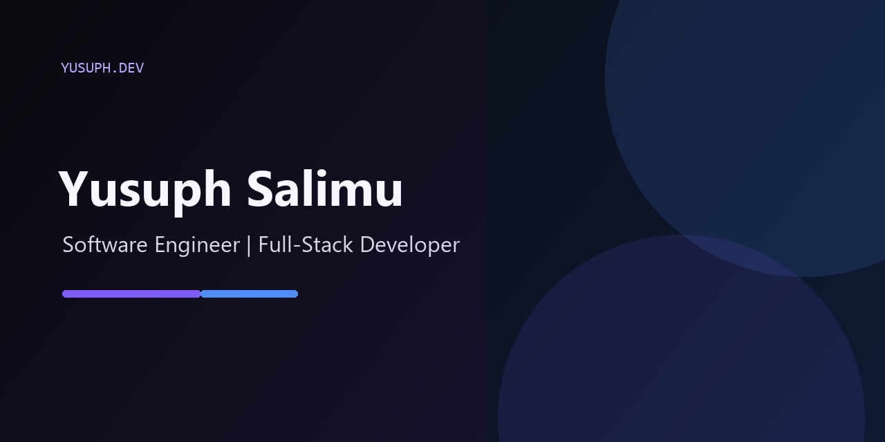

# Yusuph Salimu Portfolio

Multilingual portfolio for Yusuph Salimu, a software engineer building web platforms, business websites, and backend systems.

Live site: [https://yusuph-portfolio.vercel.app](https://yusuph-portfolio.vercel.app)

<!-- TODO: Replace this social preview with a final approved screenshot when available. -->


## Tech stack

- **Framework:** Next.js 15 (App Router)
- **Language:** TypeScript
- **Styling:** Tailwind CSS 4
- **Localization:** next-intl (English, Swahili, French)
- **Motion:** Motion
- **Testing:** Vitest
- **Content:** MDX-powered project content
- **Analytics:** Vercel Analytics and Speed Insights

## Getting started

```bash
npm install
npm run dev
npm run build
```

For the contact form, copy `.env.example` to `.env.local` and configure `RESEND_API_KEY` and `CONTACT_TO` (and a verified `RESEND_FROM` sender for production email delivery). Until configured, the form reports that email delivery is unavailable and displays the direct email address.

## Adding a project

See [docs/ADDING-A-PROJECT.md](./docs/ADDING-A-PROJECT.md) for the guided workflow for adding a new case study.

## License

This project is licensed under the MIT License. See [LICENSE](./LICENSE).
